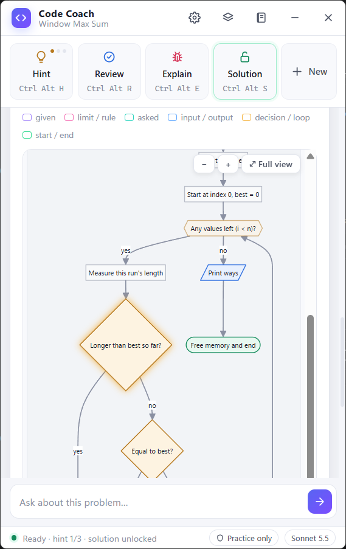

  

<h1 align="center">Code Coach</h1>

  <b>A practice coach that sits beside your coding problem, reads your screen, and teaches you to write efficient, clean code.</b> 
  Hints that get deeper step by step · code reviews · step-by-step breakdowns · algorithm & data-structure analysis · interactive flowcharts 
  Windows 10 / 11 · powered by Claude · practice only

  <a href="../../releases/latest"><b>⬇ Download the latest release</b></a> ·
  <a href="docs/HOW-IT-WORKS.md">How it works</a> ·
  <a href="#getting-started">Getting started</a> ·
  <a href="PRIVACY.md">Privacy</a>

---

Code Coach is a small always-on-top window for Windows. Open a practice problem on HackerRank, HackerEarth,
LeetCode, Codeforces or any similar site, start solving it, and press a shortcut. Code Coach looks at the problem and
your code and **coaches** you: it nudges, reviews and explains, so you build the skill yourself instead of
copying answers.

  
  
  

## What it does

| Feature | Shortcut | What you get |
|---|---|---|
| **Hint** | `Ctrl+Alt+H` | Three levels: a nudge → the approach → pseudocode. Each press goes one level deeper. |
| **Review** | `Ctrl+Alt+R` | Your code scored on 5 points (correctness, efficiency, readability, modern style, tests), plus one concrete thing to rewrite. |
| **Explain error** | `Ctrl+Alt+E` | Why a test fails or a compile error happens, and how to find the fix. |
| **Solution** | `Ctrl+Alt+S` | The full program, ready for the judge, with how it works and how it differs from yours. *Unlocks after one hint.* |
| **Step-by-step breakdown** | `Ctrl+Alt+B` | The question in plain words, a **question → code** map, every line explained, and **every word** (`scanf`, `&`, `%lld`, `malloc`…) defined. |
| **Algorithm & data structures** | `Ctrl+Alt+A` | Complexity budget from the limits, the algorithm and pseudocode, **every candidate data structure** compared, time & space, and the path from brute force to optimal with copy-ready code for each approach. |
| **Flowchart** | `Ctrl+Alt+F` | An interactive flowchart of what the question asks and how it's solved. Click any box, or **walk through** the sample input step by step. |
| **New problem** | `Ctrl+Alt+N` | Resets hints and locks for the next problem. |

You also get:
- **📓 Problem journal:** every problem you work on is saved with a summary in Code Coach's own words, its limits, pattern and key insight, plus your hints, reviews, solution and breakdowns, so you can revise later.
- **📚 Built-in reference:** 20 data structures and their operation costs, an input size → complexity table, algorithm complexities, a "how to choose" guide and an optimisation checklist. Works offline.
- **Ask box:** type any question about the problem you're on.

  
  
  

## Practice only

Code Coach is built for **learning**. It switches itself off on hiring assessments, proctored or certification
tests, interviews and live/rated contests. It checks the window title and also the screen itself. Using AI help
in those settings breaks the platforms' rules and the trust of whoever is evaluating you, so please don't try to
get around it.

## Getting started

### 1. What you need
- **Windows 10 or 11** (64-bit).
- **Microsoft Edge WebView2 Runtime.** It's already on Windows 11 and most Windows 10 PCs. If the window opens
  blank, install it from Microsoft's [WebView2 page](https://developer.microsoft.com/microsoft-edge/webview2/).
- **Your own Anthropic API key** with some credit. Code Coach is a free app, but the AI behind it is billed by
  Anthropic to **your** account. A Claude.ai Pro/Max subscription is a separate product and can't be used here.

### 2. Get an API key
1. Go to the [Anthropic Console](https://console.anthropic.com/) and sign up or sign in.
2. Add a little credit under **Billing**.
3. Open **API keys**, create a key, and copy it (it starts with `sk-ant-`).

### 3. Install and run
1. Download **`CodeCoach-v1.0.0-windows-x64.zip`** from [Releases](../../releases/latest).
2. Right-click the zip → **Extract All…** and pick a folder (for example `Documents\CodeCoach`).
3. Open the folder and double-click **`CodeCoach.exe`**.
4. **Windows SmartScreen** may say *"Windows protected your PC"*, because the app isn't code-signed. Click
   **More info → Run anyway**.
5. On first run **Settings** opens. Paste your API key, pick a model, and click **Save & test**.

### 4. Use it
1. Open a **practice** problem in your browser and start writing your solution.
2. Click your browser once, so Code Coach knows which window to read.
3. Press a shortcut, e.g. **`Ctrl+Alt+H`** for a hint or **`Ctrl+Alt+R`** for a review.

**A good order for each problem:** Hint → write your own attempt → Review → Flowchart → Solution → Breakdown →
Analysis. Then close the solution and write it again from memory.

## Models and cost

You choose the model in **Settings (⚙)**:

| Model | Best for | Price (per million tokens, input / output) |
|---|---|---|
| **Sonnet 5.5** *(default)* | Fast, everyday coaching | $2 / $10 |
| **Opus 5.5** | The strongest explanations | $4 / $20 |

Each request sends one screenshot of your problem window plus the conversation so far, and Anthropic's prompt
caching makes repeated context much cheaper. With Sonnet a typical hint or review costs a few cents; breakdowns,
analyses and flowcharts are longer answers, so they cost more. Check the
[Anthropic pricing page](https://www.anthropic.com/pricing) for current prices, and set a spending limit in the
Console if you like.

## Privacy, in short

- A screenshot of **the window you're working in** is sent to Anthropic's API, using your key, **only when you press
  a shortcut or a button**. Code Coach does not watch your screen in the background.
- Your API key is stored in **Windows Credential Manager** on your PC.
- Your journal, logs and settings stay on your PC in `%APPDATA%\CodeCoach`.
- Nothing is sent to the author of Code Coach.

Full details: [PRIVACY.md](PRIVACY.md).

## Troubleshooting

| Problem | Fix |
|---|---|
| The window is blank | Install the [WebView2 Runtime](https://developer.microsoft.com/microsoft-edge/webview2/), then restart Code Coach. |
| "Your API key was rejected" | Copy the key again from the Console and paste it in **Settings (⚙)**. |
| "Out of credit" | Add credit under **Billing** in the Anthropic Console. |
| Shortcuts don't respond | Click the problem window first. If your browser runs as administrator, run Code Coach the same way. |
| "Coach is off" | That screen looks like an assessment, interview or live contest. Code Coach only works on practice problems. |
| It can't see my code | Make the browser window larger, or scroll so the important code is visible. |

## Uninstall

1. In **Settings (⚙)** click **Remove key** (or delete `CodeCoach/AnthropicAPIKey` in Windows Credential Manager).
2. Delete the Code Coach folder.
3. Delete `%APPDATA%\CodeCoach` to remove your journal and settings.

## Licence

Code Coach is **free to download and use** for personal and educational practice. The source code is not
published, and the app may not be modified, redistributed, sold or reverse-engineered. See [LICENSE.md](LICENSE.md).
Open-source components bundled in the app are listed in [THIRD-PARTY-NOTICES.md](THIRD-PARTY-NOTICES.md); their
licence texts ship inside the download.

Code Coach is an independent project. It is not affiliated with or endorsed by Anthropic, HackerRank, HackerEarth,
LeetCode, Codeforces or any other platform. "Claude" is a trademark of Anthropic; other names belong to their owners.

---

Made by Bhagyashree Besra · 2026

