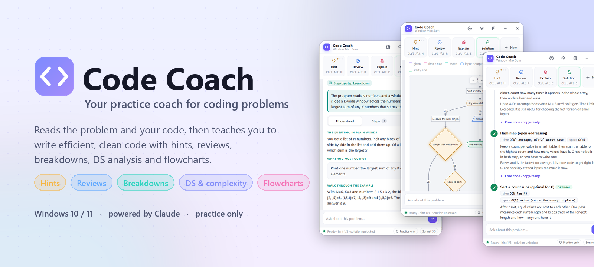
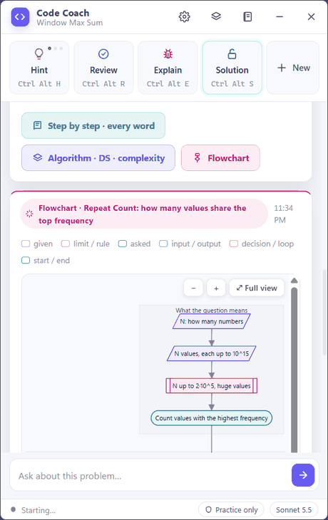
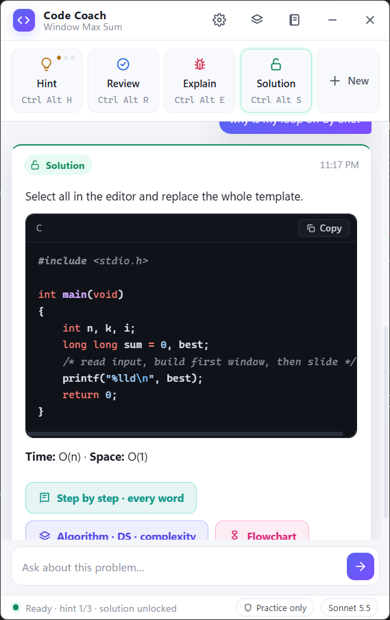
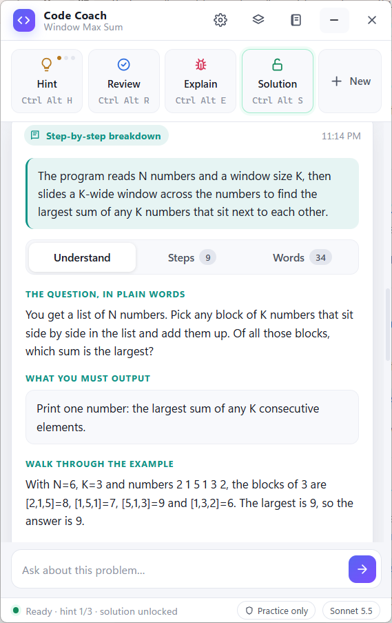
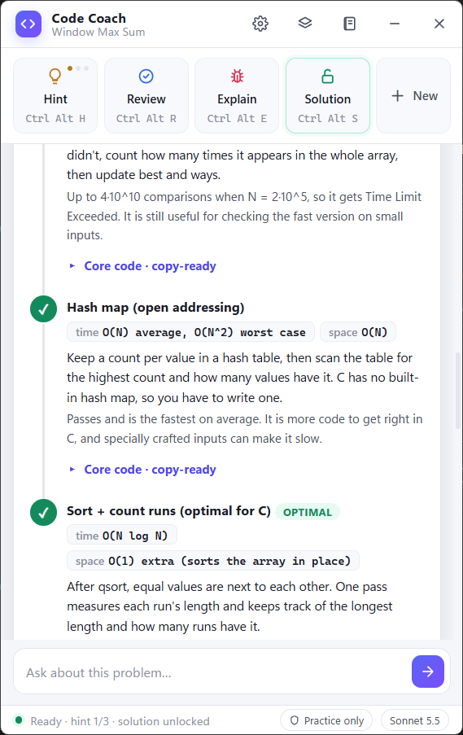
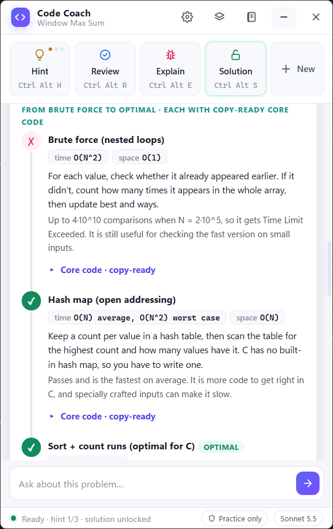
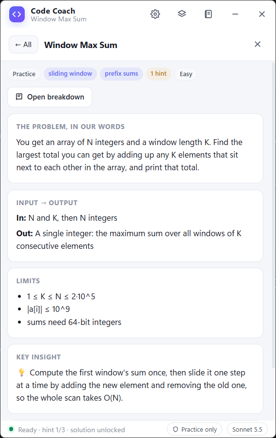
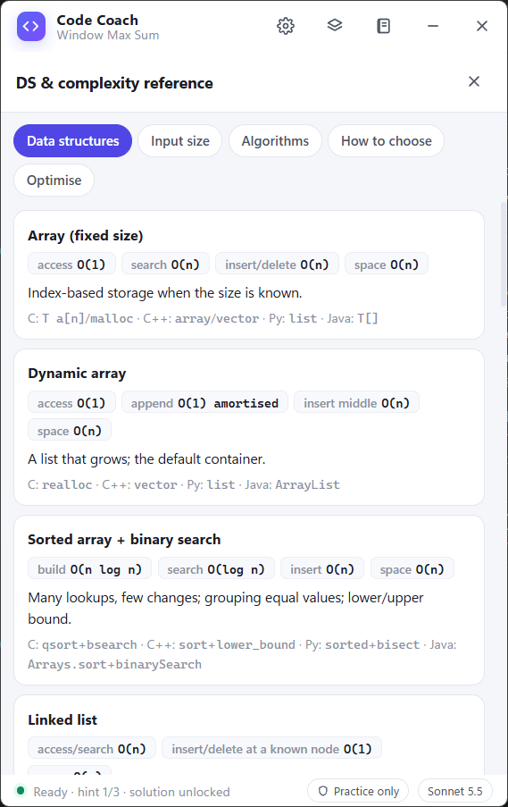
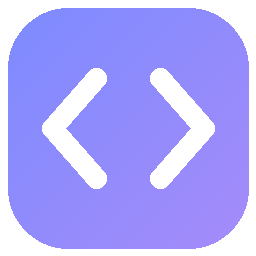

<picture>
  <source media="(prefers-color-scheme: dark)" srcset="docs/assets/banner-dark.png">
  
</picture>

  
  
  
  
  

<h3 align="center">
  Stop copying answers. Start understanding them.
</h3>

  Code Coach sits beside the problem you're practising, reads the question and your code, 
  and coaches you: nudges, reviews, line-by-line breakdowns, data-structure analysis and interactive flowcharts.

  

  <a href="#-features">Features</a> &nbsp;•&nbsp;
  <a href="#-see-it-in-action">Screenshots</a> &nbsp;•&nbsp;
  <a href="#-getting-started">Getting started</a> &nbsp;•&nbsp;
  <a href="docs/HOW-IT-WORKS.md">How it works</a> &nbsp;•&nbsp;
  <a href="PRIVACY.md">Privacy</a>

 

<table align="center">
<tr>
<td width="52%" valign="middle">

### 🎬 Watch an algorithm run

Every problem gets an **interactive flowchart**: first *what the question asks*, then *how it's solved*.
Press **▶ Walk through** and Code Coach steps through the sample input. The current box lights up and the
variables update as it goes.

Click any box to see what it means and the exact lines of code behind it.

**Works with:** HackerRank · HackerEarth · LeetCode · Codeforces · CodeChef · AtCoder, or any practice page in your browser.

</td>
<td width="48%" align="center">

</td>
</tr>
</table>

 

## ✨ Features

<table>
<tr>
<td width="33%" valign="top">

### 💡 Hints that go deeper
Three levels: **nudge → approach → pseudocode**. You get exactly as much help as you need, and no more.

<kbd>Ctrl</kbd> <kbd>Alt</kbd> <kbd>H</kbd>

</td>
<td width="33%" valign="top">

### ✅ Real code reviews
Scored on **5 points** (correctness, efficiency, readability, modern style, tests) plus one thing to rewrite.

<kbd>Ctrl</kbd> <kbd>Alt</kbd> <kbd>R</kbd>

</td>
<td width="33%" valign="top">

### 🐞 Errors explained
Why a test fails or the compiler complains, and how to find the fix yourself.

<kbd>Ctrl</kbd> <kbd>Alt</kbd> <kbd>E</kbd>

</td>
</tr>
<tr>
<td valign="top">

### 📖 Every word explained
The question in plain words, a **question → code** map, every line walked through, and every term
(`scanf`, `&`, `%lld`, `malloc`…) defined.

<kbd>Ctrl</kbd> <kbd>Alt</kbd> <kbd>B</kbd>

</td>
<td valign="top">

### 🧱 Data structures & complexity
Complexity budget from the limits, **every candidate data structure compared**, and brute force → optimal
with **copy-ready code** for each approach.

<kbd>Ctrl</kbd> <kbd>Alt</kbd> <kbd>A</kbd>

</td>
<td valign="top">

### 🔀 Interactive flowcharts
Click-to-explain boxes, zoom, full view, and a **step-by-step walk-through** of the sample input.

<kbd>Ctrl</kbd> <kbd>Alt</kbd> <kbd>F</kbd>

</td>
</tr>
<tr>
<td valign="top">

### 🔓 Judge-ready solutions
A full program that compiles first time on strict judges, plus how it answers the question. Unlocks after
**one hint**.

<kbd>Ctrl</kbd> <kbd>Alt</kbd> <kbd>S</kbd>

</td>
<td valign="top">

### 📓 Problem journal
Every problem saved with a summary, limits, pattern and key insight, plus your hints, solutions and
breakdowns for revision.

</td>
<td valign="top">

### 📚 Built-in reference
20 data structures, input size → complexity, algorithm costs, a *how to choose* guide and an
optimisation checklist. Works offline.

</td>
</tr>
</table>

 

## 📸 See it in action

<table>
<tr>
<td align="center" width="33%"> <b>Hints, reviews & solutions</b></td>
<td align="center" width="33%"> <b>Understand the question</b></td>
<td align="center" width="33%"> <b>Every data structure compared</b></td>
</tr>
<tr>
<td align="center"> <b>Brute force → optimal, with code</b></td>
<td align="center"> <b>Your problem journal</b></td>
<td align="center"> <b>Offline DS & complexity reference</b></td>
</tr>
</table>

 

> [!IMPORTANT]
> **Practice only.** Code Coach switches itself off on hiring assessments, proctored or certification tests,
> interviews and live/rated contests. It checks the window title *and* the screen itself. Please use it to
> learn, not to get around those rules.

 

## 🚀 Getting started

<table>
<tr>
<td width="25%" align="center" valign="top">

**1️⃣ &nbsp;Get a key**

Create an API key in the [Anthropic Console](https://console.anthropic.com/) and add a little credit.

</td>
<td width="25%" align="center" valign="top">

**2️⃣ &nbsp;Download**

Get the zip from [Releases](https://github.com/besrabhagyashree/code-coach/releases/latest) and **Extract All**.

</td>
<td width="25%" align="center" valign="top">

**3️⃣ &nbsp;Run**

Double-click **`CodeCoach.exe`** and paste your key.

</td>
<td width="25%" align="center" valign="top">

**4️⃣ &nbsp;Practise**

Open a problem, click it, press <kbd>Ctrl</kbd> <kbd>Alt</kbd> <kbd>H</kbd>.

</td>
</tr>
</table>

> [!NOTE]
> **You need your own Anthropic API key.** Code Coach is free, but the AI behind it is billed by Anthropic to
> your account. A Claude.ai Pro/Max subscription is a separate product and can't be used here.

> [!TIP]
> **Windows SmartScreen** may say *"Windows protected your PC"* the first time, because the app isn't
> code-signed. Click **More info → Run anyway**.

**A good order for each problem:** Hint → your own attempt → Review → Flowchart → Solution → Breakdown → Analysis.
Then close the solution and write it again from memory. That's where the learning sticks.

<b>📋 All keyboard shortcuts</b>

 

| Shortcut | Action |
|---|---|
| <kbd>Ctrl</kbd> <kbd>Alt</kbd> <kbd>H</kbd> | Hint: each press goes one level deeper (3 levels) |
| <kbd>Ctrl</kbd> <kbd>Alt</kbd> <kbd>R</kbd> | Review the code in your editor |
| <kbd>Ctrl</kbd> <kbd>Alt</kbd> <kbd>E</kbd> | Explain the error or failing test on screen |
| <kbd>Ctrl</kbd> <kbd>Alt</kbd> <kbd>S</kbd> | Full solution (after one hint) |
| <kbd>Ctrl</kbd> <kbd>Alt</kbd> <kbd>B</kbd> | Step-by-step breakdown, every word explained |
| <kbd>Ctrl</kbd> <kbd>Alt</kbd> <kbd>A</kbd> | Algorithm, data structures & complexity |
| <kbd>Ctrl</kbd> <kbd>Alt</kbd> <kbd>F</kbd> | Interactive flowchart |
| <kbd>Ctrl</kbd> <kbd>Alt</kbd> <kbd>N</kbd> | New problem (resets hints and locks) |

Click your browser once before pressing a shortcut, so Code Coach knows which window to read.

<b>💳 Models and cost</b>

 

Choose the model in **Settings (⚙)**:

| Model | Best for | Price per million tokens (input / output) |
|---|---|---|
| **Sonnet 5.5** *(default)* | Fast, everyday coaching | $2 / $10 |
| **Opus 5.5** | The strongest explanations | $4 / $20 |

Each request sends one screenshot of your problem window plus the conversation so far, and prompt caching makes
repeated context much cheaper. With Sonnet a typical hint or review costs a few cents; breakdowns, analyses and
flowcharts are longer, so they cost more. See [Anthropic pricing](https://www.anthropic.com/pricing), and set a
spending limit in the Console if you like.

<b>🔒 Privacy</b>

 

- A screenshot of **the window you're working in** is sent to Anthropic's API with your key, **only when you press
  a shortcut or a button**. There's no background screen watching.
- Your API key is stored in **Windows Credential Manager**.
- Your journal, logs and settings stay on your PC in `%APPDATA%\CodeCoach`.
- **Nothing is sent to the author.**

Full details: [PRIVACY.md](PRIVACY.md)

<b>🛠️ Troubleshooting</b>

 

| Problem | Fix |
|---|---|
| The window is blank | Install the [WebView2 Runtime](https://developer.microsoft.com/microsoft-edge/webview2/), then restart. |
| "Your API key was rejected" | Copy the key again from the Console and paste it in **Settings (⚙)**. |
| "Out of credit" | Add credit under **Billing** in the Anthropic Console. |
| Shortcuts don't respond | Click the problem window first. If your browser runs as administrator, run Code Coach the same way. |
| "Coach is off" | That screen looks like an assessment, interview or live contest. |
| It can't see my code | Make the browser larger, or scroll so the important code is visible. |

<b>🧹 Uninstall</b>

 

1. In **Settings (⚙)** click **Remove key** (or delete `CodeCoach/AnthropicAPIKey` in Windows Credential Manager).
2. Delete the Code Coach folder.
3. Delete `%APPDATA%\CodeCoach` to remove your journal and settings.

<b>💻 Requirements</b>

 

- Windows 10 or 11, 64-bit
- Microsoft Edge WebView2 Runtime (already on Windows 11 and most Windows 10 PCs)
- An Anthropic API key with credit
- An internet connection

 

## 📄 Licence

Code Coach is **free to download and use** for personal and educational practice. The source code is not
published; the app may not be modified, redistributed, sold or reverse-engineered. See [LICENSE.md](LICENSE.md).
Bundled open-source components are listed in [THIRD-PARTY-NOTICES.md](THIRD-PARTY-NOTICES.md).

Code Coach is an independent project, not affiliated with or endorsed by Anthropic, HackerRank, HackerEarth,
LeetCode, Codeforces, CodeChef or AtCoder. "Claude" is a trademark of Anthropic; other names belong to their owners.

 

   
  Made with care by <b>Bhagyashree Besra</b> · 2026

