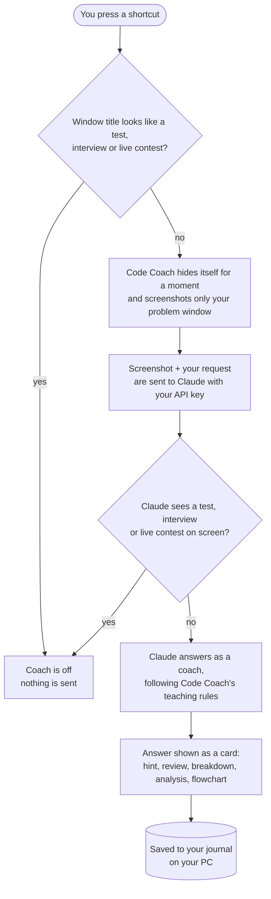

# How Code Coach works

This page explains what happens inside Code Coach, without the source code.

## The flow of one request

1. **You choose when.** Nothing happens until you press a shortcut or a button. There's no background screen
   watching.
2. **The practice-only guard runs twice.** First the app checks the window title (words like *assessment*,
   *proctor*, *interview*, *contest*). If that passes, the model also checks the screenshot for timers,
   webcam/proctoring notices and contest pages. Either check can switch the coach off.
3. **Only your problem window is captured.** Code Coach remembers the last window you clicked that isn't itself,
   moves itself out of the way for a split second so it doesn't cover the problem, and captures just that window.
4. **The model is told to teach.** Every request carries Code Coach's coaching rules: give hints by level, don't
   copy the problem statement, use judge-safe code, explain in plain English, and only give full solutions in
   Solution mode.
5. **One conversation per problem.** Hint 2 builds on hint 1, and a review knows which hints you've had. **New
   problem** (`Ctrl+Alt+N`) starts a fresh conversation.

## The modes

| Mode | What Claude is asked to do | How it's shown |
|---|---|---|
| Hint 1 / 2 / 3 | Nudge → name the approach and target complexity → language-neutral pseudocode | Hint card with progress dots |
| Review | Check whether you've really attempted it, then score 5 points and set one rewrite task | Review card |
| Explain | Find which input breaks your code or what the compiler is complaining about | Error card |
| Solution | A complete program that compiles first time on strict judges (for C: declarations at the top of blocks, `long long` where needed, memory freed), then how it answers the question | Solution card with **Copy** |
| Breakdown | Structured data: the question restated, clues, a question → code map, steps covering every line, every term defined | Tabs: **Understand · Steps · Words** (searchable glossary) |
| Analysis | Structured data: complexity budget, algorithm, 4–7 data structures compared, brute force → optimal with core code for each approach | Tabs: **Algorithm · Structures · Complexity · Approaches** |
| Flowchart | Structured data: boxes, arrows and a step-by-step trace of the sample input | An interactive diagram: click boxes, play the walk-through, zoom, full view |

For breakdowns, analyses and flowcharts, Claude returns **structured data** rather than plain text. Code Coach turns
that into the timelines, tables, tabs and diagrams you see.

## When Solution, Analysis and Flowchart unlock

They're locked at the start of each problem and **unlock after one hint**, or after a review of code you wrote
yourself. A review of the untouched starter template doesn't count. The idea is that you always see the key
insight before the full answer.

## The journal

The first time you ask about a problem, a separate quick request writes a **journal card**: a summary in Code
Coach's own words (never the platform's statement), the input/output shape, key limits, the pattern and the key
insight. Code Coach then records your activity (hints used, reviews, whether you opened the solution) and keeps
the solution, breakdown, analysis and flowchart so you can reopen them later. Everything is stored as files on
your PC.

## What's stored where

| What | Where |
|---|---|
| Your API key | Windows Credential Manager (`CodeCoach/AnthropicAPIKey`) |
| Settings (chosen model) | `%APPDATA%\CodeCoach\settings.json` |
| Journal | `%APPDATA%\CodeCoach\journal\` (one file per problem) |
| Logs (for troubleshooting) | `%APPDATA%\CodeCoach\logs\` |
| Screenshots | Not saved; each one is sent with its request and discarded |

## Under the hood

- **Interface:** a modern web-style interface in a native window, using the Microsoft Edge WebView2 engine built
  into Windows.
- **AI:** Anthropic's Claude via the official Messages API, with your own key. Sonnet 5.5 is the default and Opus
  5.5 is optional. Prompt caching keeps repeated context cheap, and if the model declines a request, the API
  automatically retries it on a fallback model.
- **Flowcharts:** laid out with the open-source Mermaid library, bundled so it works offline.
- **Code colouring:** Pygments.
- **Shortcuts:** global hotkeys that work while your browser is focused.

## Limits

- Code Coach reads **pixels**, not your editor's text, so very long code that doesn't fit on screen may be missed.
  Enlarge or scroll the window.
- It doesn't run your code. The platform's judge is still the final word on whether it passes.
- Like any AI, it can occasionally be wrong. Treat solutions as something to understand and test, not to trust
  blindly.
